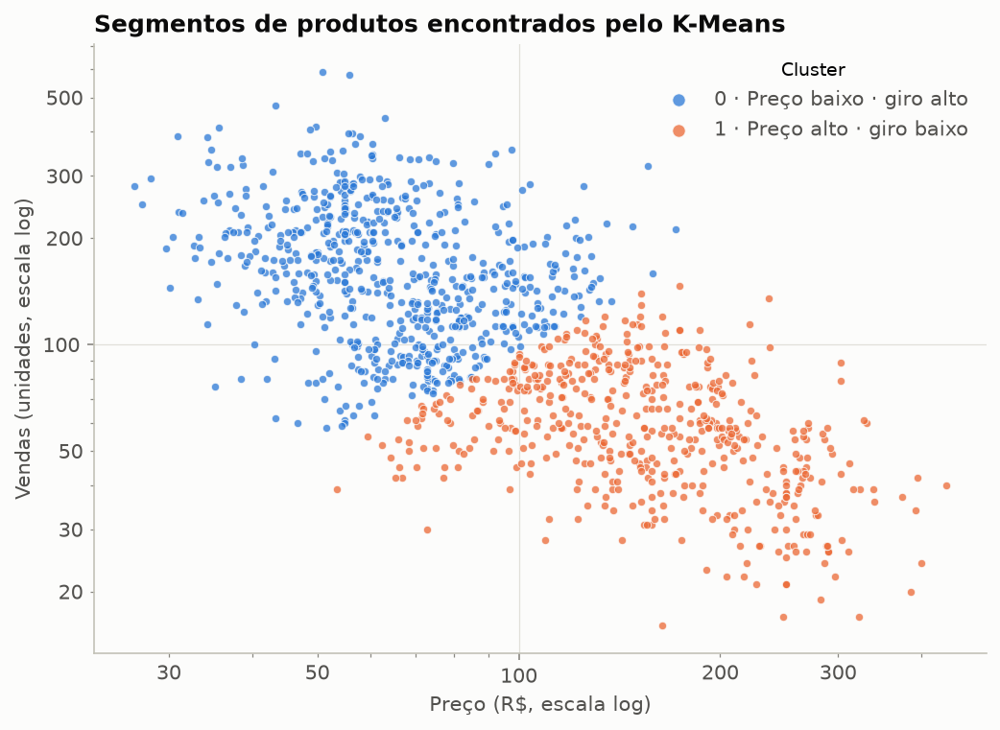
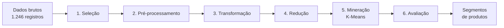
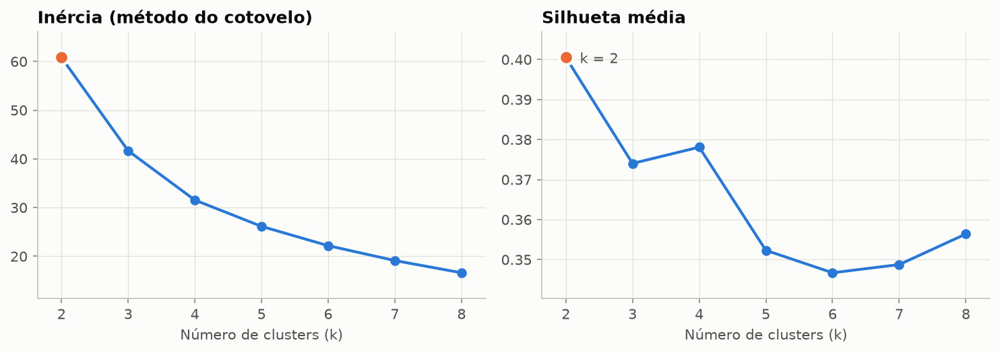
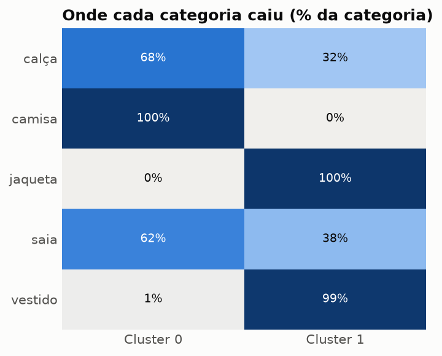
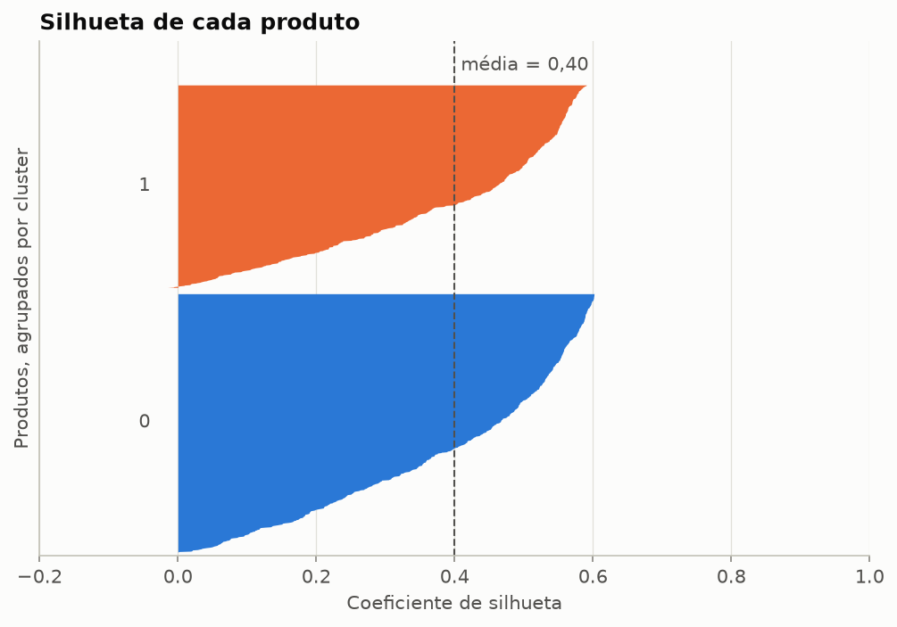

# KDD — Segmentação de Produtos com K-Means

Pipeline completo de **Descoberta de Conhecimento em Bases de Dados (KDD)** aplicado a produtos de uma loja de roupas. O projeto percorre as seis etapas do processo, de dados brutos e "sujos" até segmentos de produtos interpretáveis para decisões de precificação, promoção e estoque.

> **Pergunta de negócio:** os produtos se organizam em grupos naturais segundo preço e volume de vendas?



## Etapas



| Etapa | Módulo | O que faz |
|---|---|---|
| 1. Seleção | [`kdd/selecao.py`](kdd/selecao.py) | Redução vertical: mantém `ID_Produto`, `Categoria`, `Preço` e `Vendas` e descarta 6 atributos irrelevantes. |
| 2. Pré-processamento | [`kdd/preprocessamento.py`](kdd/preprocessamento.py) | Normaliza textos (`" CALCA"` → `calça`), converte `"R$ 1.234,56"`, remove duplicatas, inválidos e erros de digitação (cerca de Tukey) e preenche ausentes com a mediana da categoria. |
| 3. Transformação | [`kdd/transformacao.py`](kdd/transformacao.py) | Cria `Faixa_Preço` por tercis e `Receita`; aplica log + Min-Max para corrigir a assimetria. |
| 4. Redução | [`kdd/reducao.py`](kdd/reducao.py) | Filtros de variância e correlação para escolher os atributos do agrupamento; ANOVA F como diagnóstico. |
| 5. Mineração | [`kdd/mineracao.py`](kdd/mineracao.py) | K-Means com k de 2 a 8, escolhido pela maior silhueta. |
| 6. Avaliação | [`kdd/avaliacao.py`](kdd/avaliacao.py) | Silhueta, Davies-Bouldin e Calinski-Harabasz, além do perfil e nome de cada segmento e da validação com a categoria. |

O passo a passo comentado, com tabelas e gráficos, está no notebook [`notebooks/kdd_produtos.ipynb`](notebooks/kdd_produtos.ipynb).

## Resultados

| Métrica | Valor | Leitura |
|---|---|---|
| k escolhido | **2** | maior silhueta entre k = 2 e 8 |
| Silhueta | **0,40** | estrutura moderada (−1 a 1) |
| Davies-Bouldin | **0,97** | menor é melhor |
| Calinski-Harabasz | **1.014** | maior é melhor |

| Cluster | Segmento | Produtos | Preço mediano | Vendas medianas | % da receita | Composição |
|---|---|---|---|---|---|---|
| 0 | Preço baixo · giro alto | 659 | R$ 63,51 | 158 | 60% | todas as camisas, ~2/3 das calças e saias |
| 1 | Preço alto · giro baixo | 517 | R$ 153,69 | 58 | 40% | vestidos, jaquetas, ~1/3 das calças e saias |

<p>
  
</p>
<p>
  
  
</p>

**Conclusões**

- O catálogo se divide em um segmento de **volume** e um **premium**. O de volume concentra 60% da receita e combina com reposição frequente e promoções; o premium combina com foco em margem e estoque enxuto.
- **Calças e saias aparecem nos dois segmentos.** Parte delas se comporta como produto de entrada e parte como premium, então esses itens merecem revisão individual de preço.
- A silhueta de 0,40 mostra que preço e vendas formam um contínuo, e não grupos isolados. A segmentação é útil para orientar decisões, mas as fronteiras entre os segmentos não são rígidas.

O relatório completo de cada execução fica em [`reports/resultados.md`](reports/resultados.md) e [`reports/metricas.json`](reports/metricas.json).

## Como executar

```bash
git clone https://github.com/<seu-usuario>/kdd-produtos.git
cd kdd-produtos
python -m venv .venv
# Windows: .venv\Scripts\activate   |   Linux/macOS: source .venv/bin/activate
pip install -r requirements.txt

python main.py                  # executa o pipeline e gera reports/
python main.py --k 3            # força o número de clusters
python main.py --regerar-dados  # recria a base sintética
python main.py --entrada minha_base.csv  # outra base com as mesmas colunas

pytest                          # 14 testes
```

## Estrutura

```
kdd-produtos/
├── main.py                 # ponto de entrada (CLI)
├── kdd/                    # uma etapa do KDD por módulo
│   ├── config.py
│   ├── gerar_dados.py      # base sintética reprodutível
│   ├── selecao.py
│   ├── preprocessamento.py
│   ├── transformacao.py
│   ├── reducao.py
│   ├── mineracao.py
│   ├── avaliacao.py
│   ├── graficos.py
│   └── pipeline.py         # orquestra as etapas e grava as saídas
├── notebooks/kdd_produtos.ipynb
├── data/raw/produtos.csv   # dados brutos (sintéticos)
├── data/processed/         # gerado na execução
├── reports/                # métricas, perfis e figuras
└── tests/
```

## Sobre os dados

A base é **sintética** e reprodutível (semente 42), gerada por [`kdd/gerar_dados.py`](kdd/gerar_dados.py). Ela tem 1.246 registros de 5 categorias. Os problemas típicos de bases reais foram incluídos de propósito para exercitar o pré-processamento: grafias inconsistentes, preços em texto no formato brasileiro, 4% de ausentes, valores negativos ou zerados, erros de digitação (R$ 99.999) e 46 duplicatas.

## Evolução em relação à versão original

Este repositório é uma reescrita do trabalho de KDD feito para a disciplina de Banco de Dados II (Ciência da Computação — FCT/UNESP), originalmente executado em notebooks no Google Colab.

| Versão original | Esta versão |
|---|---|
| Orquestrador dependente do Colab/Drive, com `%run` dentro de função (não roda fora do IPython) | Pacote Python comum, CLI e notebook; roda em qualquer máquina |
| Dados não versionados | Base sintética reprodutível, versionada |
| Preenchimento com média/mediana global | Mediana **por categoria** |
| Faixa de preço por mapeamento fixo | Tercis (`qcut`), com faixas equilibradas |
| Min-Max direto | log + Min-Max, para que extremos não dominem o K-Means |
| `SelectKBest` com a categoria como alvo, mantendo **1** atributo | Filtros não supervisionados (variância e correlação); ANOVA só como diagnóstico |
| k = 3 fixo | k escolhido pela silhueta, com o cotovelo como apoio |
| Apenas silhueta | Silhueta, Davies-Bouldin, Calinski-Harabasz e validação externa com a categoria |
| Colunas de preço/vendas **simuladas** na avaliação | Perfis calculados sobre os dados reais do pipeline |
| Sem testes | 14 testes com `pytest` |

A silhueta original (0,80) foi calculada sobre um único atributo, escolhido por ser o que mais separava as categorias. Isso torna o agrupamento quase unidimensional e infla a métrica. O valor atual (0,40) é menor, mas mede a estrutura real em várias dimensões.

## Autoria

Carolina Jordão — Bacharelado em Ciência da Computação, FCT/UNESP.
